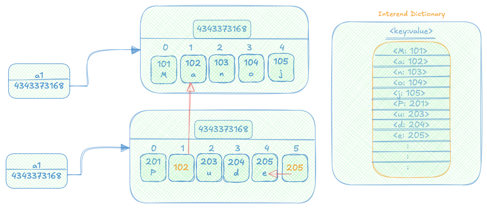
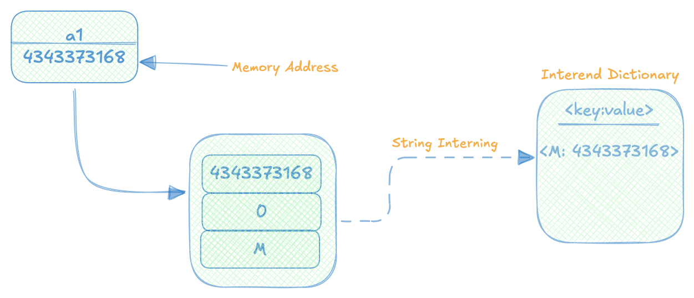
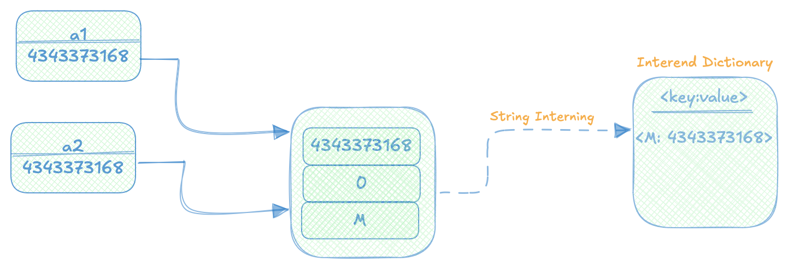

Let say you write, `name = "Manoj"` and ever got a question in your mind, what really happining internally when you write this line of code in Python? OR, ever wondered when we compare two strings that looks exact same but somehow behave differently. For example,

```python
a = 'manoj'
b = 'manoj'
print(a is b)  # True

c = 'hello this is my blog'
d = 'hello this is my blog'
print(c is d)  # False
```

Above, both the pair of strings contains the exact same text. The `==` retruns `True` means the value are same (match). But when we used `is` retruns `False` for the second example, what's going on here? As a beginner, when i saw this behaviour at first, I also got confused, so don't worry you are not alone.

In this post, we will deep dive into understanding the fascinating world of string, how it stored in memory level, why it behave this way and so on. I tried my best to explain you the concept in simple terms as i can.

## What is String in Python?

In python, string is a sequence of unicode characters enclosed with quotes. For example, `a = data` is a string containing sequence of characters `d`, `a`, `t` and `a`. In simple terms, we can say anything inside `single` or `double` quotes python treats it as a string ( which can includes numbers, letters and symbols).

```python
# Different ways to create strings in Python
string1 = "Hello"  # Double quotes
string2 = 'World'  # Single quotes
string3 = """This is a
multiline string"""  # Triple quotes
string4 = str(123)  # Converting other types to string
```



> Here's a catch, strings are **immutable** in Python. What I mean is, once we create a string, we cannot change it in place.
>
> For example, if we try to change `a='hello'` to `a = 'world'` it results in creating a new string in memory and now `a` starts to point to that memory address where `world` is stored.

```python
# Trying to modify a string (will fail)
s = "hello"
try:
    s[0] = "H"  # This will raise TypeError
except TypeError as e:
    print(f"Error: {e}")  # Error: 'str' object does not support item assignment

# Instead, we need to create a new string
s = "H" + s[1:]  # Creates a new string "Hello"
print(s)  # Hello
```

## How strings are stored in Memory?

In python, strings are extremely memory efficient in terms of memory cost. What I mean is, python is smart about how to handle them. Instead of storing every string we create a separate object in memory, where python tries to reuse the existing strings when possible. But how python does that?

To understand this properly, we need to first know two key concepts:

**Immutability:** As I said earlier, string in python cannot be changed once defined.

**Interning:** Because of this immutability, python is able to safely reuse strings without worrying about accidental changes in shared strings that might affect another part. This is where the concept of interning comes. Let's dive deeper,

### String Interning

In simple terms, string interning is a process ensuring that the only a single memory location is allocated for a single unique characters and if in future, the same character occurs then python simply return the previously stored address. This helps to save a lot of memory cost.

> **String** internally, uses a dictionary called **Interned Dictionary** to store string characters as key and the memory address of that key as a value.

Lets take a look at the above examples, `a,b = 'manoj'` and `c,d = hello this is my blog'`.

```python
a = "manoj"
b = "manoj"
print(a is b)  # True
# Same memory location (interned)
```

Here, `'manoj'` a short string made up of ASCII letters, which python automatically **interned**. That's why both the `a`and `b` point to same memory location.

```python
c = "hello this is my blog"
d = "hello this is my blog"
print(a is b)  # False
# Different memory location (NOT interned)
```

For above long string, python doesn't automatically intern all the strings, even though the values are same (`==` returns `True`), but python stores them in separate locations so we got `False`.

> 🤔 **Why?**
>
> Because usually strings with long text, with spaces in between or any special characters, and strings created using concatenation, aren't automatically interned in Python.
>
> Is this means, we can interned our string mannully if we want? The answer is **yes**, python give the programmer like us the control. If we want we can manually interned above string using `sys.intern()` function,

```python
import sys

c = sys.intern("hello this is my blog")
d = sys.intern("hello this is my blog")
print(c is d)  # True
```

Using `sys.intern()` function, it forces python to store only the one copy of the string and reuse it again instead of storing them in seperate memory location.

## QN/A

So far, we know what interning is, from an outside perspective, now let's understand what actually happens internally (inside memory) using some visualization.

### 1. What actually happen internally, when python interned a string? How an interned dictionary actually works?

Suppose we have single character string `a1` and we assigned it to new variable `a2`.

```python
a1 = "M"
a2 = a1
print(a1) # M
print(a2) # M
print(id(a1)) # 4343373168
print(id(a2)) # 4343373168
```



In above code, when we first created a string `a1 = "M"` python then check, **do I already have an interned copy of "M" in our interned dictionary (initially empty)?**. If **yes**, python reuse the existing one. If **no**, a new key-value pair get created where 'M' set as a key and it's memory address as a value and stored in the interned dictionary.



Now, when we assign `a2 = a1`, python again starts the checking process, in this case as we already have a interned copy of "M" in our intrened dictionary, python simply reuses the exisiting memory reference of "M" because it is immutable and already interned.

> Here, we are not creating two different strings.
> Firstly, single string `a1 = "M"` is created and when we assign `a2 = a1`, the address of a1 sent to `a2` and now it starts to point to the
> **same object** in memory that `a1` is pointing to. This is called reference type assignment in python. > _That's why, `id(a1) == id(a2)` return True and `a1 is a2` return True which means a1 and a2 not only look the same but they are the same object in memory._

I hope, you got an clear idea about how string interend dictionary works in memory. Now, earlier, let's understand why strings are extremely memory efficient in terms of cost?

### 2. Why String are extremely memory efficient?

Now, we know how python interns string, using an interned dictionary which is very similar to normal dictionary. But here's an intresting twist, even individual characters inside multi-character strings are sometimes interned in python. For example,

```python
f_name = "Manoj"
l_name = "Paudel"
print(f_name) # Manoj
print(l_name) # Paudel
print(id(f_name)) # 4394741744
print(id(l_name)) # 4394732336
```

Both the strings have different object in memory. Now, I ask you a question,

> **QN.
> If I compare common character from both, let say character `'a'` will both `id(f_name[1]) and id(l_name[1])` have same memory address?**

Let's look,

```python
print(id(f_name[1])) # 4343129200
print(id(l_name[1])) # 4343129200
```

Whoa 😳, same character `'a'`, have a same memory location even though `'a'` live inside completely different string `f_name` and `l_name`. Unusual, right?
